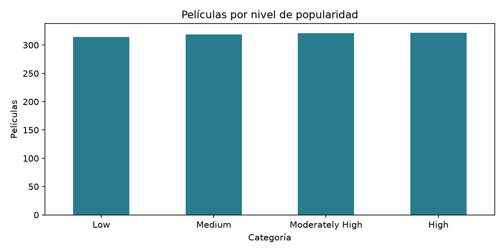
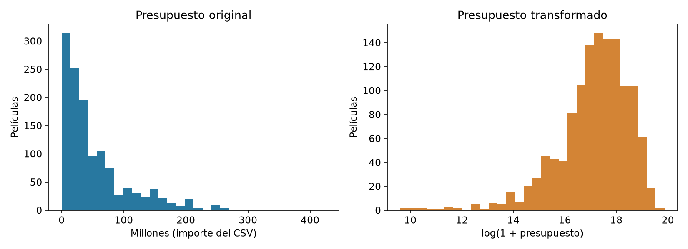
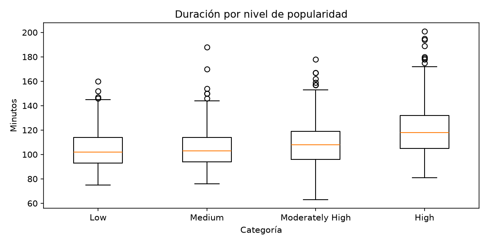
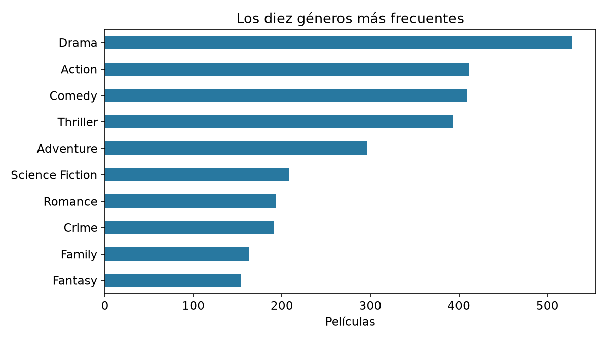
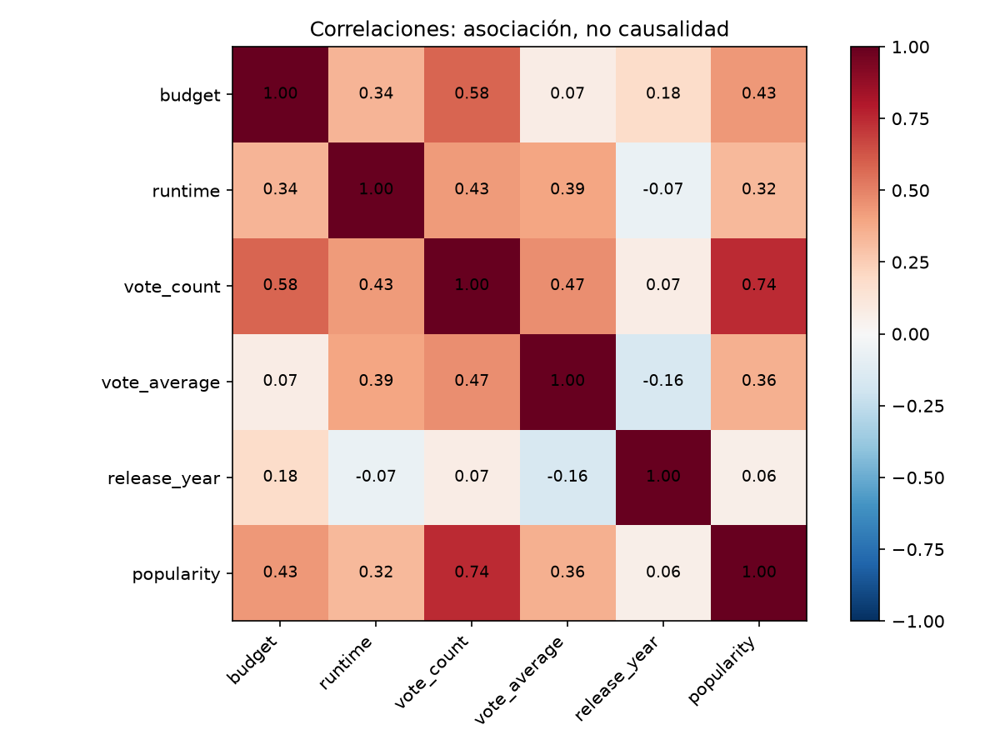
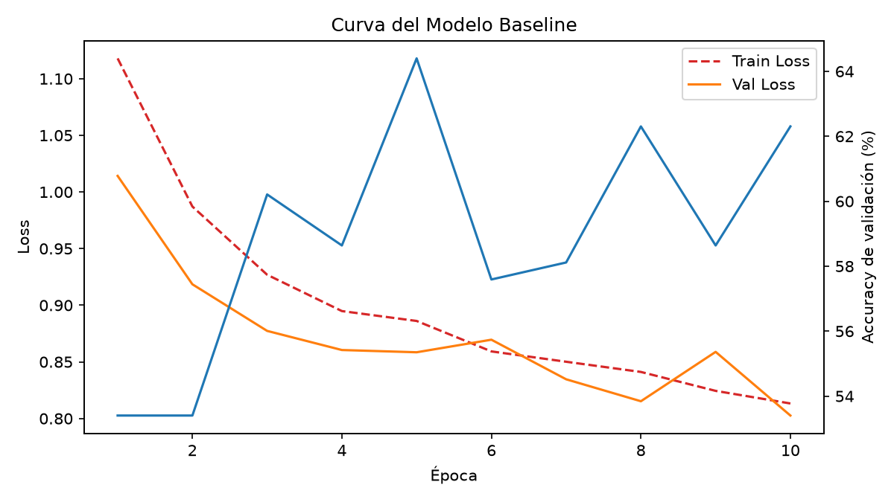
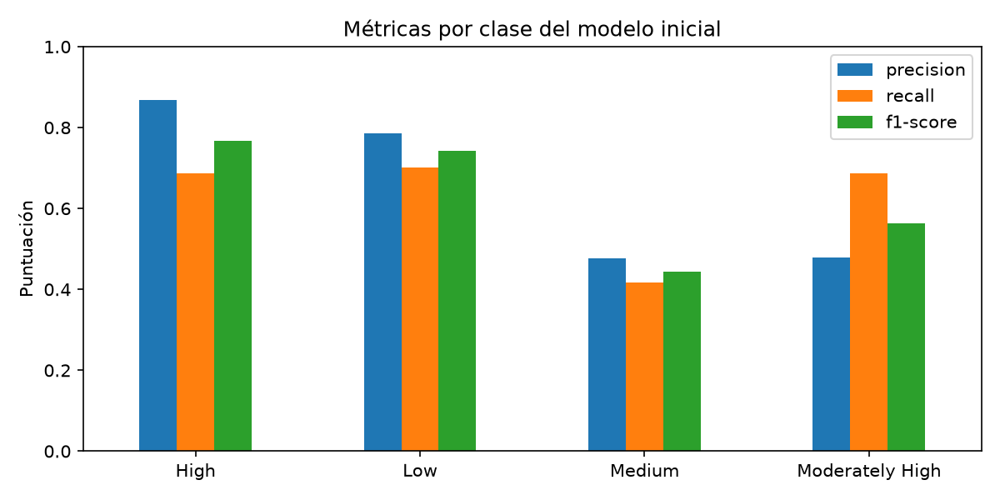

En este proyecto analizamos el sector cinematográfico a través del conjunto de datos de TMDB con el objetivo de predecir el nivel de popularidad de una película (clasificándola en diferentes categorías como baja, media, media-alta o alta) mediante un modelo de clasificación multiclase basado en redes neuronales con PyTorch. El flujo de trabajo abarca desde un Análisis Exploratorio de Datos (EDA) —donde limpiamos registros, tratamos valores nulos y analizamos variables clave como presupuesto, ingresos, géneros o duración— hasta la definición de la arquitectura de deep learning y la experimentación sistemática con hiperparámetros (capas ocultas, tamaño de lote y tasa de aprendizaje) mediante una estrategia de búsqueda en malla (Grid Search) para identificar la configuración con mejor rendimiento predictivo.

## 1. Fase A (Obtención de Datos y Análisis Exploratorio (EDA))

En este apartado en referencia al *Exploratory Data Analysis* (EDA), fundamentamos el dataset de los datos complementando  patrones, identificando anomalías y limpiando linterferencias de datos.


### 1.1. Carga de datos y limpieza inicial

En este paso importamos las librerías necesarias (`pandas` y `numpy`), realizamos la lectura del dataset original y ejecutamos el proceso de depuración de registros duplicados e inconsistentes.

```python
# Cargamos los datos del dataset original
df_original = pd.read_csv(CARPETA / 'TMBD Movie Dataset.csv')
print(f"Dimensiones iniciales: {df_original.shape[0]} filas, {df_original.shape[1]} columnas")

df = df_original.copy()

# Eliminación de películas duplicadas por ID
filas_duplicadas = df.duplicated(subset=['id']).sum()
if filas_duplicadas > 0:
    df = df.drop_duplicates(subset=['id'], keep='first')

# Filtrado inicial por umbral comercial de presupuesto y recaudación
len_antes_br = len(df)
budget_revenue = (df['budget'] > 10000) & (df['revenue'] > 10000)
df_clean = df[budget_revenue].copy()
filas_eliminadas_br = len_antes_br - len(df_clean)
print(f"Se eliminaron {filas_eliminadas_br} filas con presupuesto o recaudación incoherentes")


# Convertir fechas a formato datetime
df_clean['release_date'] = pd.to_datetime(df_clean['release_date'], errors='coerce')
# El año separado se ha contrastado con la fuente pública. Corregimos 12 siglos.
fechas_incoherentes = (df_clean['release_date'].dt.year != df_clean['release_year']) & df_clean['release_date'].notna()
fechas = df_clean.loc[fechas_incoherentes, ['id', 'original_title', 'release_date']].copy()
fechas.columns = ['id', 'original_title', 'fecha_recibida']
fechas_nuevas = (df_clean.loc[fechas_incoherentes, 'release_year'].astype(int).astype(str)
                 + '-' + df_clean.loc[fechas_incoherentes, 'release_date'].dt.strftime('%m-%d'))
df_clean.loc[fechas_incoherentes, 'release_date'] = pd.to_datetime(fechas_nuevas)
fechas['fecha_corregida'] = df_clean.loc[fechas_incoherentes, 'release_date']
fechas.to_csv(RESULTADOS / 'fechas_corregidas.csv', index=False)

# Columnas críticas donde un valor de 0 o un nulo (NaN) es un error inaceptable
columnas_criticas = ['runtime', 'budget', 'revenue', 'vote_count', 'vote_average']

# Transformamos cualquier '0' en un nulo en esas columnas
df_clean[columnas_criticas] = df_clean[columnas_criticas].replace(0, np.nan)

# Eliminamos todas las filas que tengan un NaN o fecha nula
nulos_antes_drop = len(df_clean)
df_clean = df_clean.dropna(subset=columnas_criticas + ['release_date', 'popularity_level'])
# No convertimos una etiqueta ausente en una quinta clase llamada 'nan'.
filas_eliminadas_totales = nulos_antes_drop - len(df_clean)

print(f"Se eliminaron {filas_eliminadas_totales} filas por contener valores nulos o ceros")

# Conservar texto intacto y asegurar tipos numéricos enteros
df_clean['budget'] = df_clean['budget'].astype(int)
df_clean['revenue'] = df_clean['revenue'].astype(int)

# Resumen final
print(f"\nRESUMEN DE LIMPIEZA: {len(df_original)} registros iniciales -> {len(df_clean)} registros limpios finales.")

# Guardar el archivo final manteniendo el resto de columnas disponibles
df_clean.to_csv(CARPETA / 'IMBD_Movie_Dataset_limpio.csv', index=False)
```

### 1.2. Muestra y Vista Previa del Dataset Limpio

A continuación se muestra una lectura de prueba adaptada automáticamente a los nombres de columna presentes en el archivo:

```python
# Selección dinámica de columnas para evitar errores si alguna variable varía su nombre
columnas_deseadas = ['id', 'title', 'original_title', 'release_date', 'budget', 'revenue', 'runtime', 'genres']
columnas_existentes = [col for col in columnas_deseadas if col in df_clean.columns]

if not columnas_existentes:
    columnas_existentes = list(df_clean.columns[:7])

df_clean[columnas_existentes].head()
```

#### Muestra real del archivo limpio



### 1.3. Resumen Estadístico de las Variables Cuantitativas

```python
# Descripción estadística general de las variables cuantitativas disponibles
columnas_num = [col for col in ['budget', 'revenue', 'runtime'] if col in df_clean.columns]
if columnas_num:
    df_clean[columnas_num].describe().round(2)
else:
    df_clean.describe().round(2)
```




Una variable cuantitativa es aquella que expresa una cantidad o valor numérico sobre el cual tiene sentido realizar operaciones matemáticas. En nuestro esquema de matería elementos como el presupuesto y la recaudación son indispensables para poder conocer si una película ha sido exitosa o no.Bajo esa lógica, convertimos presupuesto y recaudación a enteros porque los importes del archivo se representan sin fracciones; esto no garantiza ahorrar memoria.


### 1.4. Resumen final del apartado

Entonces ¿Qué tenemos?¿Qué estamos viendo y haciendo?

Hemos partido del fichero inicial del Dataset con el fin de recogerlo como una muestra de datos, revisamos duplicados, nulos, tipos y fechas. Aplicamos el filtro comercial del equipo y excluimos una película sin categoría. Conservamos la muestra recibida y documentamos sus límites; no representa todas las películas.

```python
# No creamos una categoría "nan" a partir de una etiqueta desconocida.
df_clean = df_clean.dropna(subset=columnas_criticas + ['release_date', 'popularity_level'])
df_clean.to_csv(CARPETA / 'IMBD_Movie_Dataset_limpio.csv', index=False)
```

### 1.5. Diagnóstico y visualización





Un nulo significa dato desconocido. El script del grupo transforma ceros de las columnas críticas en nulos y elimina esas filas. En esta muestra, la exclusión adicional corresponde a la categoría ausente. No ha sido necesario imputar las cinco entradas. Las doce fechas corregidas quedan registradas en `resultados/fechas_corregidas.csv`.

El filtro de presupuesto y recaudación superior a 10.000 es una decisión heredada de selección comercial. Un importe bajo no demuestra por sí solo un error.

Para detectar atípicos usamos IQR: valores fuera de Q1 − 1,5 × IQR y Q3 + 1,5 × IQR. Conservamos los extremos que pueden ser válidos, como superproducciones. StandardScaler ajusta las escalas al preparar las entradas, pero no elimina ni comprime los extremos. Probar logaritmos queda como posible mejora futura.











## 2. Fase B

Consiste en implementar la red neuronal en PyTorch para resolver el problema de clasificación, realizando un ajuste sistemático de hiperparámetros (capas, neuronas, batch size y learning rate) para encontrar la arquitectura con mejor capacidad predictiva.

### 2.1 Fase B: Definición y Entrenamiento del Modelo

**El problema elegido**


Producir una obra cinematográfica exige una inversión enorme de recursos humanos, creativos y financieros, por lo que comprender qué factores impulsan el impacto de una película en el público es clave para la industria.

Nuestro propósito de este proyecto es abordar el problema como una clasificación multiclase del nivel de popularidad (High, Moderately High, Medium, Low) a partir de sus características principales.

En nuestro conjunto de datos, esta variable objetivo se representa mediante la etiqueta `popularity_level`, la cual codificamos numéricamente para alimentar nuestro modelo de clasificación multiclase.


#### 2.1.1. Definición de Variables

Para poder llevar acabo la medición del exito  es necesario diferenciar entre:

* **Variable Dependiente ($y$):** Categoría de popularidad de la película (variable categórica multiclase derivada de los datos).
* **Variables Explicativas ($X$):** Conjunto de 5 variables numéricas continuas/discretas: presupuesto, duración, número de votos, valoración media y año de estreno.

```python
# 2. Seleccionar las variables explicativas (X) y la variable objetivo (Y)
feature_cols = ['budget', 'runtime', 'vote_count', 'vote_average', 'release_year']
X = df[feature_cols].values

# Convertir la variable categórica 'popularity_level' a etiquetas numéricas enteras
label_encoder = LabelEncoder()
if df['popularity_level'].isna().any():
    raise ValueError('Hay etiquetas ausentes. Ejecutar EDA.py primero.')
y = label_encoder.fit_transform(df['popularity_level'])

# 3. Reservar prueba final y separar entrenamiento y validación (70/15/15).
indices = np.arange(len(df))
idx_train, idx_reserva = train_test_split(indices, test_size=0.30, random_state=42, stratify=y)
idx_val, idx_test = train_test_split(idx_reserva, test_size=0.50, random_state=42, stratify=y[idx_reserva])
X_train, X_val, X_test = X[idx_train], X[idx_val], X[idx_test]
y_train, y_val, y_test = y[idx_train], y[idx_val], y[idx_test]

# 4. Normalizar los datos numéricos (media 0 y desviación típica 1)
scaler = StandardScaler()
X_train = scaler.fit_transform(X_train)
X_val = scaler.transform(X_val)
X_test = scaler.transform(X_test)
```

`popularity_level` procede de agrupar la puntuación `popularity` en cuatro categorías; los cortes son propios de esta muestra. Excluimos `popularity` de las entradas porque determina directamente la respuesta. La nota media y los votos son posteriores al estreno: clasificamos películas ya observadas y no predecimos su éxito antes de estrenarse.

La separación se hace una sola vez con semilla 42 y proporciones aproximadas 70/15/15. `stratify` conserva las proporciones de clases. Solo entrenamiento ajusta StandardScaler; validación y prueba utilizan su transformación. Prueba queda reservada hasta elegir la configuración.

#### 2.1.2. Justificación del Uso de Redes Neuronales
Probamos una red neuronal porque permite estudiar relaciones no lineales e interacciones entre las entradas. Comparamos después con regresión logística, que también es un clasificador. No damos por supuesta la superioridad de la red:

1. **Relaciones No Lineales:** La relación entre variables económicas (presupuesto y recaudación) y el éxito/popularidad de una película no es puramente proporcional. Existen efectos de escala y rendimientos decrecientes.

**Ejemplo ilustrativo, no resultado medido:** Un aumento constante en la variable no produce un aumento constante en la popularidad.

**Caso A** (De 1 a 20 millones de presupuesto): Pasar de una película independiente a un presupuesto medio permite contratar actores conocidos y hacer promoción. Esto podría asociarse a un aumento de popularidad.

**Caso B** (De 200 a 220 millones de presupuesto): En una película de presupuesto muy alto, gastar 20 millones más podría tener un efecto diferente sobre la popularidad. Es una posibilidad ilustrativa, no una relación demostrada.


2. **Interacciones Complejas:** Una red neuronal perceptrón multicapa (MLP) permite combinar las 5 características mediante capas ocultas con funciones de activación no lineales (ReLU), capturando patrones y combinaciones complejas que una regresión simple no puede modelar.

**Ejemplo ilustrativo:** El impacto de una variable puede depender de las demás.

Película de 180 minutos con nota 5.0: Podría despertar menos interés que otra película mejor valorada. No hemos demostrado esa causa con el dataset.

Película de 180 minutos con nota 8.8: podría atraer más interés. Estos ejemplos sirven para explicar posibles interacciones; no son predicciones reales de la red.

3. **Clasificación Multiclase:** La arquitectura ajusta múltiples *logits* de salida simultáneamente mediante la función `CrossEntropyLoss`, comparando los logits con la categoría correcta. Ser multiclase no exige por sí solo una red neuronal.


Punto: Generar puntuaciones (logits) para decidir a qué categoría pertenece una película.

El orden lo establece `LabelEncoder`: **0 = High (Alta), 1 = Low (Baja), 2 = Medium (Media), 3 = Moderately High (Media-alta)**.

Ejemplo inventado para entender la salida: `Logits = [4.5, -2.5, -0.8, 1.2]`. El valor mayor está en la posición 0, por lo que se predice High. Son puntuaciones, no porcentajes, y el ejemplo no corresponde a una película de prueba.

### 2.2 Fase B: Modulo inicial


#### 2.2.1 Código

**Inicialización del modelo, pérdida y optimizador**
```python
model = PeliculasNeuralNetwork(input_dim=5, hidden_dim=64, output_dim=4)
criterio = nn.CrossEntropyLoss()
optimizador = optim.Adam(model.parameters(), lr=0.01)
```
**Función para evaluar la red sin calcular gradientes**

```python
import torch
import torch.nn as nn

class PeliculasNeuralNetwork(nn.Module):
    def __init__(self, input_dim, hidden_dim, output_dim):
        super(PeliculasNeuralNetwork, self).__init__()
        self.layer1 = nn.Linear(input_dim, hidden_dim)
        self.relu = nn.ReLU()
        self.layer2 = nn.Linear(hidden_dim, hidden_dim)
        self.output = nn.Linear(hidden_dim, output_dim)

    def forward(self, x):
        out = self.layer1(x)
        out = self.relu(out)
        out = self.layer2(out)
        out = self.relu(out)
        out = self.output(out)
        return out

def evaluar(model, loader, criterio):
    model.eval()
    loss_total, aciertos, total = 0.0, 0, 0
    todas_reales, todas_pred = [], []

    with torch.no_grad():
        for batch_X, batch_y in loader:
            outputs = model(batch_X)
            loss = criterio(outputs, batch_y)

            predichas = outputs.argmax(dim=1)

            loss_total += loss.item() * len(batch_y)
            aciertos += (predichas == batch_y).sum().item()
            total += len(batch_y)

            todas_reales.extend(batch_y.tolist())
            todas_pred.extend(predichas.tolist())

    return loss_total / total, aciertos / total, todas_reales, todas_pred
```

#### 2.2.2. Datos del Entrenamiento




**Evolución por Época**



#### 2.2.3. Reporte de Clasificación por Clase



#### 2.2.4. Gráficos


1. Línea Roja Discontinua 🟥 — Pérdida de Entrenamiento (Train Loss)
2. Línea Naranja Continua 🟧 — Pérdida de Validación (Val Loss)
3. Línea Azul Continua 🟦 — Precisión de Validación (Val Accuracy %)




### 2.3 Fase B: Resumen final del apartado
¿Qué estamos viendo y haciendo?
Hemos partido del conjunto de datos ya filtrado y pulcro de la fase previa. Una vez resueltos los problemas de nulos, formatos e incompatibilidades de tipos, tomamos esos datos empaquetados en lotes (train_loader y val_loader) para construir, entrenar y evaluar nuestro modelo baseline en PyTorch.

El objetivo es establecer un punto de partida de rendimiento midiendo la precisión (accuracy) y la pérdida (loss) al intentar predecir la categoría de popularidad de una película a partir de sus 5 características cuantitativas.

## 3. Fase C: Experimentación Sistemática y Búsqueda en Malla (Grid Search)

Tras evaluar el modelo *Baseline*, implementamos una estrategia de **Grid Search** automatizada para evaluar el impacto de tres hiperparámetros clave en la capacidad de generalización de la red neuronal:

1. **Profundidad de la red:** Evaluación de 1, 2 y 3 capas ocultas (`[32]`, `[64, 32]`, `[128, 64, 32]`).
2. **Tamaño del lote (*Batch Size*):** Comparativa entre lotes de 16, 32 y 64 muestras.
3. **Tasa de aprendizaje (*Learning Rate*):** Variación de orden de magnitud ($10^{-2}$, $10^{-3}$, $10^{-4}$).

Cada configuración se entrena con **tres semillas distintas (42, 7 y 21)** sobre los mismos conjuntos fijados (**893 registros de entrenamiento y 191 de validación**). Esto suma un total de **21 entrenamientos** de 15 épocas.

---

### 3.1. Código del Pipeline Modular

**Arquitectura Dinámica del Modelo**

```python
#| eval: false

import torch
import torch.nn as nn

class PeliculasNeuralNetwork(nn.Module):
    def __init__(self, input_dim, hidden_layers, output_dim, activation=nn.ReLU):
        super().__init__()
        layers = []
        in_dim = input_dim

        # Construcción dinámica de capas ocultas
        for h_dim in hidden_layers:
            layers.append(nn.Linear(in_dim, h_dim))
            layers.append(activation())
            in_dim = h_dim

        # Capa final de salida (logits)
        layers.append(nn.Linear(in_dim, output_dim))
        self.network = nn.Sequential(*layers)

    def forward(self, x):
        return self.network(x)
```
* **¿Qué hace?** Construye la estructura interna de la red de forma modular según la configuración recibida.
* **Clave técnica:** Automatiza la conexión entre la dimensión de entrada, las capas ocultas intermedias y los *logits* de salida.

---

**Gestor Dinámico de Carga de Datos y Evaluación**

```python
#| eval: false

from torch.utils.data import DataLoader, TensorDataset

def crear_dataloaders(X_train, y_train, X_val, y_val, batch_size):
    train_dataset = TensorDataset(X_train, y_train)
    val_dataset = TensorDataset(X_val, y_val)

    train_loader = DataLoader(train_dataset, batch_size=batch_size, shuffle=True)
    val_loader = DataLoader(val_dataset, batch_size=batch_size, shuffle=False)

    return train_loader, val_loader

def evaluar(model, loader, criterio):
    model.eval()
    loss_total, aciertos, total = 0.0, 0, 0

    with torch.no_grad():
        for batch_X, batch_y in loader:
            outputs = model(batch_X)
            loss = criterio(outputs, batch_y)
            predichas = outputs.argmax(dim=1)

            loss_total += loss.item() * len(batch_y)
            aciertos += (predichas == batch_y).sum().item()
            total += len(batch_y)

    return loss_total / total, aciertos / total
```
* **¿Qué hace?** Gestiona el empaquetado en lotes y mide la precisión/pérdida en inferencia sin alterar los pesos.
* **Clave técnica:** `torch.no_grad()` inhabilita el cálculo de gradientes, reduciendo drásticamente el consumo de memoria durante la evaluación.

---

### 3.2. Tabla Comparativa de Resultados Reales

| ID | Capas Ocultas | Nº Capas | Batch Size | Learning Rate | Train Loss | Val Loss | Val Accuracy (%) | Desv. Acc | Tiempo (s) |
|:--:|:-------------:|:--------:|:----------:|:-------------:|:----------:|:--------:|:----------------:|:---------:|:----------:|
| **Exp_1** | `[32]` | 1 | 32 | 0.0100 | 0.8312 | **0.8168** | **61.78%** | 0.2027 | 1.39 |
| **Exp_5** | `[64, 32]` | 2 | 64 | 0.0100 | 0.7792 | **0.8030** | **61.26%** | 0.1428 | 2.28 |
| **Exp_2** | `[64, 32]` | 2 | 32 | 0.0100 | 0.7822 | 0.8149 | 60.73% | 0.2397 | 0.52 |
| **Exp_4** | `[64, 32]` | 2 | 16 | 0.0100 | 0.7835 | 0.8210 | 60.38% | 0.4330 | 1.09 |
| **Exp_3** | `[128, 64, 32]` | 3 | 32 | 0.0100 | 0.7797 | 0.8683 | 59.51% | 0.2813 | 2.47 |
| **Exp_6** | `[64, 32]` | 2 | 32 | 0.0010 | 0.8795 | 0.8714 | 58.29% | 0.2377 | 0.80 |
| **Exp_7** | `[64, 32]` | 2 | 32 | 0.0001 | 1.1969 | 1.1975 | 45.90% | 0.2392 | 0.60 |

```{python}
#| label: fig-comparativa-grid-real
#| fig-cap: "Comparativa de precisión en validación y pérdida entre las 7 configuraciones del Grid Search."
#| fig-align: "center"
#| echo: false
#| warning: false
#| message: false

import pandas as pd
import matplotlib.pyplot as plt

data = [
    {"ID": "Exp_1", "Val Acc": 61.78, "Train Loss": 0.8312, "Val Loss": 0.8168},
    {"ID": "Exp_5", "Val Acc": 61.26, "Train Loss": 0.7792, "Val Loss": 0.8030},
    {"ID": "Exp_2", "Val Acc": 60.73, "Train Loss": 0.7822, "Val Loss": 0.8149},
    {"ID": "Exp_4", "Val Acc": 60.38, "Train Loss": 0.7835, "Val Loss": 0.8210},
    {"ID": "Exp_3", "Val Acc": 59.51, "Train Loss": 0.7797, "Val Loss": 0.8683},
    {"ID": "Exp_6", "Val Acc": 58.29, "Train Loss": 0.8795, "Val Loss": 0.8714},
    {"ID": "Exp_7", "Val Acc": 45.90, "Train Loss": 1.1969, "Val Loss": 1.1975},
]

df = pd.DataFrame(data)

fig, (ax1, ax2) = plt.subplots(1, 2, figsize=(14, 5))

# Subgráfico 1: Accuracy de Validación
colors = ['#2ca02c' if id == 'Exp_1' else '#1f77b4' for id in df['ID']]
bars = ax1.bar(df['ID'], df['Val Acc'], color=colors, edgecolor='black', alpha=0.85)
ax1.set_title('Accuracy en Validación (%)', fontsize=11, fontweight='bold')
ax1.set_ylabel('Accuracy (%)')
ax1.set_ylim(40, 70)
ax1.grid(axis='y', linestyle='--', alpha=0.6)

for bar in bars:
    yval = bar.get_height()
    ax1.text(bar.get_x() + bar.get_width()/2.0, yval + 0.8, f"{yval:.2f}%", ha='center', va='bottom', fontsize=8, fontweight='bold')

# Subgráfico 2: Comparativa de Pérdida
x = range(len(df))
width = 0.35
ax2.bar([p - width/2 for p in x], df['Train Loss'], width=width, label='Train Loss', color='#ff7f0e', alpha=0.85)
ax2.bar([p + width/2 for p in x], df['Val Loss'], width=width, label='Val Loss', color='#d62728', alpha=0.85)
ax2.set_xticks(x)
ax2.set_xticklabels(df['ID'])
ax2.set_title('Comparativa de Pérdida (Loss)', fontsize=11, fontweight='bold')
ax2.set_ylabel('Loss')
ax2.grid(axis='y', linestyle='--', alpha=0.6)
ax2.legend()

plt.tight_layout()
plt.show()
```

---

### 3.3. Análisis e Interpretación de Resultados

Del análisis del Grid Search se derivan las siguientes conclusiones técnicas clave:

1. **Simplicidad frente a Complejidad (`Exp_1` Ganador):**  
   El modelo de una sola capa oculta de 32 neuronas (**`Exp_1`**) logró la mayor precisión media en validación (**61.78%**). Aumentar la profundidad a 3 capas (`Exp_3`) redujo la *Train Loss* a 0.7797 pero elevó la *Val Loss* a 0.8683, lo que indica que arquitecturas más complejas comienzan a sufrir un leve sobreajuste (*overfitting*) en este dataset.

2. **Sensibilidad a la Tasa de Aprendizaje (*Learning Rate*):**  
   Una tasa de $0.01$ fue indispensable para alcanzar la convergencia en 15 épocas. Reducir la tasa a $0.0001$ (**`Exp_7`**) provocó un colapso en el rendimiento (**45.90%**), ya que las actualizaciones de los pesos fueron demasiado pequeñas para salir de regiones subóptimas del espacio de pérdida.

3. **Impacto del Tamaño del Lote (*Batch Size*):**  
   Lotes de mayor tamaño (`Batch Size = 64` en **`Exp_5`**) mostraron un rendimiento muy cercano al ganador (**61.26%**) con una menor pérdida en validación (0.8030) y alta estabilidad entre semillas (desviación de solo 0.14).

---

### 3.4. Evaluación Final sobre el Conjunto de Prueba

Tras seleccionar **`Exp_1`** utilizando únicamente el conjunto de validación, procedimos a evaluar los modelos sobre el conjunto de prueba inédito (192 registros):

| Modelo | Accuracy Prueba (%) |
| :--- | :---: |
| **Clase mayoritaria** | 25.52% |
| **Regresión logística** | 63.54% |
| **Red neuronal (`Exp_1`)** | **67.53%** |

El modelo final alcanza una **precisión en prueba del 67.53%**, superando en casi **4 puntos porcentuales** a la Regresión Logística y demostrando la capacidad de la red neuronal para aprender patrones no lineales eficaces a partir de las variables de entrada.

## 4. Limitaciones, Reproducción y Trabajo Futuro

El modelo desarrollado debe entenderse como una **prueba de concepto académica** y no como un sistema listo para entornos de producción. Aunque la red neuronal superó a las *baselines* lineales en la muestra analizada (películas de 1961 a 2015), el alcance del proyecto está acotado por la naturaleza de los datos y el uso de variables generadas únicamente tras el lanzamiento comercial (`vote_count` y `vote_average`).

Para garantizar un rigor analítico completo, se detallan las limitaciones metodológicas, la viabilidad en la industria real y las líneas de desarrollo futuro.

---

### 4.1. Análisis Crítico y Viabilidad Real

* **Muestra reducida y sesgada:** El conjunto de datos es histórico (1961-2015) y previamente filtrado. No representa la totalidad de la oferta cinematográfica global ni los patrones de consumo actuales.
* **Trazabilidad y etiquetas heredadas:** Aunque se verificó una fuente pública equivalente y se reprodujeron las etiquetas, el análisis está condicionado por la selección original de casos y sus criterios de categorización.
* **Fuga de información (*Data Leakage*):** El uso de métricas posteriores al estreno impide que la red funcione como un predictor previo al rodaje para guiar decisiones de inversión financiera.
* **Filtro comercial restrictivo:** El umbral de presupuesto mínimo ($10.000) excluye producciones independientes válidas, limitando la extrapolación de los resultados a proyectos de bajo presupuesto.
* **Evaluación en partición única:** Evaluar sobre una sola división de datos acota la generalización estadística. Las tres inicializaciones empleadas mitigan la variabilidad de los pesos, pero no sustituyen una validación cruzada sistemática.

::: {.callout-warning}
## Brecha para Entornos de Producción
A día de hoy, el modelo ignora cerca del **80% de los factores determinantes** en la industria cinematográfica actual:

* **Reparto y Dirección:** Carece de métricas sobre el tirón mediático o historial de actores y directores.
* **Propiedad Intelectual (IP):** No distingue si un título pertenece a un universo o franquicia consolidada (ej. Marvel, Star Wars) o si es una idea original.
* **Impacto en Redes y Marketing:** No contempla el presupuesto publicitario ni la conversación en redes sociales previa al estreno.
:::

---

### 4.2. Rigor Metodológico y Líneas de Mejora

* **Garantía de preprocesado ciego:** Para evitar contaminación de datos, el análisis exploratorio (EDA) describe la muestra completa, pero todos los parámetros de normalización y escalado se ajustaron exclusivamente sobre el conjunto de entrenamiento. La prueba final se mantuvo totalmente inédita hasta la evaluación definitiva.
* **Validación Cruzada y Divisibilidad Temporal:** Implementar un esquema de *K-Fold Cross-Validation* junto con una separación por corte temporal (*Temporal Split*) para medir la capacidad de la red al predecir películas de épocas posteriores a su entrenamiento.
* **Aislamiento de Variables Pre-estreno:** Estudiar el impacto de eliminar el número de votos y la calificación media, comparando el rendimiento del modelo post-estreno actual con una arquitectura basada estrictamente en variables previas al rodaje.
## 5. Alcance y Conclusiones propias

**¿Se acerca más a los aciertos o a los errores?**
Al analizar los resultados, vemos que el modelo funciona muy bien identificando los casos extremos, logrando más de un 83% de F1-Score en la categoría de alta popularidad y reconociendo los grandes fracasos sin problema. Sin embargo, tiene un punto ciego claro en la zona media, ya que se equivoca en casi la mitad de los casos de popularidad media o media-alta al confundirlos sistemáticamente con la categoría baja. La red acierta fácilmente en lo más evidente (los taquillazos o los fracasos estrepitosos), pero duda bastante a la hora de clasificar el cine de rango intermedio.

**¿Es realmente útil?**
A nivel práctico, el modelo presenta una limitación lógica clave: al incluir variables como la nota media y el número de votos, que solo existen tras el lanzamiento, no sirve para predecir el éxito a priori ni ayuda a un estudio a decidir si financiar un proyecto antes de rodar. Sin embargo, su utilidad real se encuentra en la etapa posterior al estreno, siendo una herramienta muy práctica para que plataformas como Netflix o Prime Video automaticen la organización y segmentación de grandes catálogos de películas en función de la recepción final del público.

### Extras

El código completo está en los cuatro scripts del grupo. Para reproducir los resultados, ejecutar desde `redes neuronales`:

```bash
python EDA.py
python preparacion_datos_entrenamiento.py
python preparacion_hiperparametros_modulares.py
python generar_informe.py
quarto render
```

Los fragmentos de este documento se muestran para explicar el código. Las tablas y figuras se generan desde las ejecuciones de los scripts y se incorporan al HTML con Quarto. No se copian resultados antiguos a mano.

**Datos:** [TMDb Movies Dataset, Juzer Shakir, Kaggle](https://www.kaggle.com/datasets/juzershakir/tmdb-movies-dataset). La fuente pública equivalente contiene 10.866 películas; hemos contrastado las 1.287 de la copia recibida, las columnas y las etiquetas. Esto no acredita el enlace de descarga original. La ficha indica licencia Unknown. Los detalles y hashes se conservan en `datos/fuente.md` y `datos/fuente_verificada.json`.

**Herramientas:** [PyTorch](https://pytorch.org/), [pandas](https://pandas.pydata.org/), [NumPy](https://numpy.org/), [Matplotlib](https://matplotlib.org/), [scikit-learn](https://scikit-learn.org/) y [Quarto](https://quarto.org/).