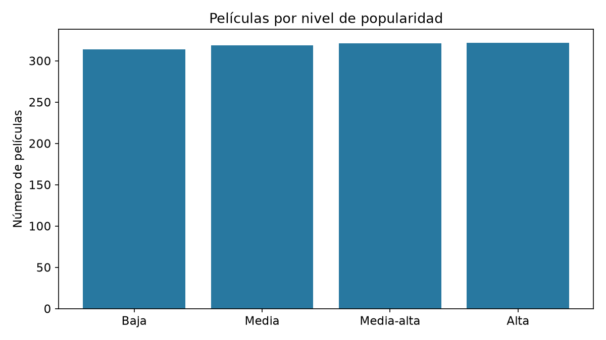

# Introducción

Hemos elegido el **cine** como temática del proyecto. Nos interesa estudiar
si las características de las películas permiten distinguir cuatro niveles
de popularidad: **baja, media, media-alta y alta**.

El objetivo es comparar distintas redes neuronales de clasificación. No
intentamos predecir una cifra de recaudación, ni afirmar que una película
vaya a triunfar antes de estrenarse. Utilizamos votos y valoraciones del
público, por lo que nuestro análisis es **posterior al estreno**.

Este informe continúa el trabajo de la rama `desarrollo` del equipo. Mantenemos
su selección comercial de películas, sus cinco variables explicativas, el
modelo inicial y las siete configuraciones de partida. Añadimos una octava
comparación para estudiar la anchura de una capa, repetimos con tres semillas
y reservamos una prueba final independiente. Las tablas y figuras de resultados
se generan con las ejecuciones, en lugar de escribir las cifras a mano.

## Datos y procedencia

El archivo de partida es `datos/peliculas_original.csv`, llamado originalmente
`TMBD Movie Dataset.csv`. Es la copia que ya estaba en el
[repositorio del equipo, rama desarrollo](https://github.com/William-glj/Redes-Neuronales-Team-RDTG-/tree/desarrollo).
Contiene 1.287 películas con años de estreno entre 1961 y 2015.

Su estructura coincide con una selección de datos históricos de TMDB:
presupuesto, recaudación, duración, géneros, votos y puntuaciones.
Esto **no demuestra el origen exacto** de esta versión ni cómo se hizo la
selección. No presentamos estos 1.287 registros como el catálogo completo
de TMDB ni como el dataset de 5.000 películas de Kaggle.

::: {.callout-warning}
## Procedencia que debe confirmar el equipo
Falta recuperar el enlace de descarga original de esta selección y sus
condiciones de uso. La copia recibida no lo documenta. El repositorio identifica
el archivo utilizado, pero no sustituye la atribución a la fuente original.
:::

Para la definición del indicador consultamos la
[documentación oficial de TMDB](https://developer.themoviedb.org/docs/popularity-and-trending).
Actualmente describe la popularidad usando, entre otros factores, votos,
visitas y fecha de estreno. No podemos asegurar que su fórmula histórica
fuera idéntica. El número de votos es una señal muy relacionada con la
popularidad: esta clasificación reconstruye un indicador de la muestra,
no demuestra una relación causal.

# Exploración y limpieza

Primero leemos los datos con pandas y hacemos una copia para conservar el
archivo recibido. NumPy se utiliza para revisar valores no finitos,
transformar variables y preparar las entradas.

```python
df_original = pd.read_csv("datos/peliculas_original.csv")
df = df_original.copy()
print(df.shape)
print(df.isna().sum())
```

Quitamos el índice exportado y revisamos duplicados por `id`. Eliminamos las
filas sin una categoría válida. Los valores numéricos imposibles se marcan
como nulos; si hay que imputarlos, su mediana se calcula después de dividir
los datos y usando únicamente entrenamiento.

```python
df = df.drop_duplicates(subset="id").copy()
df = df[df["popularity_level"].isin(CATEGORIAS)].copy()
```



## Visualización de los datos

Las figuras siguientes se generan con matplotlib. Cada una responde a una
pregunta del análisis; no se usan como entradas de la red.

### ¿Están equilibradas las categorías?



Las categorías tienen prácticamente el mismo tamaño. La accuracy resulta
fácil de interpretar en esta muestra, pero añadimos F1 macro para evaluar
todas las categorías con el mismo peso.

### ¿Por qué transformar el presupuesto?


Los importes financieros abarcan varios órdenes de magnitud. El logaritmo
reduce la distancia entre importes pequeños y grandes. No corrige posibles
errores de unidades ni convierte cifras sospechosas en datos fiables.

```python
for columna in ["budget", "vote_count"]:
    valores[columna] = np.log1p(valores[columna])
```

### ¿La duración separa las categorías?


Las cajas permiten comparar medianas, dispersión y extremos. El solapamiento
entre grupos indica que una duración por sí sola no separa claramente las
cuatro categorías. Una observación fuera de los bigotes no es necesariamente
un error.

### ¿Qué géneros aparecen más?


Una película puede tener varios géneros separados por `|`. Por eso la suma
de estas barras puede superar el número de películas. Creamos una entrada
0/1 para contar las apariciones en este gráfico. Los géneros se exploran en
el EDA, pero no entran al modelo de cinco variables que ya tenía el equipo.

### ¿Qué variables se relacionan?


La correlación resume asociaciones lineales y puede verse influida por
valores extremos. Una correlación alta no demuestra causalidad. Analizamos
`popularity` en esta figura para entender el problema, pero la excluimos
de las entradas del clasificador. Los votos son una señal especialmente
relacionada con el indicador, lo que refuerza el carácter retrospectivo del ejercicio.

# Definición del problema

## Qué queremos clasificar

La variable dependiente es `popularity_level`. Conservamos las cuatro
etiquetas que ya venían en el archivo. Sus rangos son compatibles con una
división por cuartiles, pero **no disponemos del procedimiento original**.
No recalculamos sus límites con la prueba final. Los rangos observados se
guardan en `resultados/rangos_categorias.csv` como auditoría descriptiva.

| Etiqueta original | Nombre en el informe | Código para PyTorch |
| --- | --- | --- |
| Low | Baja | 0 |
| Medium | Media | 1 |
| Moderately High | Media-alta | 2 |
| High | Alta | 3 |

Aunque existe un orden, tratamos las etiquetas como cuatro clases nominales:
la pérdida no distingue entre un error a la categoría vecina y otro más lejano.

## Variables explicativas

| Variable | Uso |
| --- | --- |
| `budget` | Presupuesto: logaritmo y normalización. |
| `runtime` | Duración: normalización. |
| `vote_count` | Número de votos: logaritmo y normalización. |
| `vote_average` | Nota media: normalización. |
| `release_year` | Año: normalización. |

Excluimos `popularity` porque está directamente ligada a la etiqueta.
También excluimos identificadores, título, URLs y textos libres para
mantener el modelo tabular del equipo. `revenue` y `genres` se estudian en el
EDA, pero no se añaden a las cinco entradas originales. No añadimos `profit`, `budget_adj` ni
`revenue_adj`: evitamos variables derivadas o redundantes para esta primera
comparación.

## Por qué probar una red neuronal

El problema combina cinco variables numéricas para clasificar
cuatro grupos que se solapan. Una red con ReLU puede aprender relaciones no
lineales e interacciones. Esto justifica **experimentar** con ella, no afirmar
de antemano que sea superior a un modelo sencillo. Incluimos una regresión
logística multiclase como referencia. A pesar de su nombre, la regresión
logística es un clasificador; no estamos resolviendo una regresión de una
variable numérica.

# Preparación y entrenamiento

## Separación de los datos

Utilizamos `train_test_split`, como en el código inicial del equipo, con una
semilla fija y `stratify` para conservar las proporciones de las clases.
Reservamos aproximadamente 70 % para entrenamiento, 15 % para validación y
15 % para prueba. El redondeo impide que todos los tamaños sean porcentajes exactos.

- **Entrenamiento:** actualiza los pesos y permite calcular el preprocesado.
- **Validación:** selecciona la configuración y la época que conservamos.
- **Prueba:** se consulta al final para evaluar la configuración elegida.

Las medianas, medias y desviaciones se obtienen solo de entrenamiento.
Después se aplican las mismas transformaciones a los otros conjuntos.

```python
medianas = entreno[FEATURE_COLS].median()
scaler = StandardScaler()
x_entreno = scaler.fit_transform(valores_numericos[0])
x_val = scaler.transform(valores_numericos[1])
x_prueba = scaler.transform(valores_numericos[2])
```

`valores_numericos[0]` contiene entrenamiento, después de imputar y aplicar los
logaritmos. Normalizar evita que la escala del presupuesto domine a la de
la nota o la duración. `StandardScaler` también trata las columnas constantes
para evitar una división por cero.

## Construcción de la red

Utilizamos **PyTorch**, con capas `Linear` y activación `ReLU`. Las capas
ocultas cambian entre experimentos; la salida siempre tiene cuatro neuronas.
Una red de ejemplo con dos capas ocultas es:

```python
modelo = nn.Sequential(
    nn.Linear(5, 64),
    nn.ReLU(),
    nn.Linear(64, 32),
    nn.ReLU(),
    nn.Linear(32, 4)
)
```

`Linear` combina las entradas con pesos y sesgos. `ReLU` introduce no
linealidad y sustituye los valores negativos por cero. Las cuatro salidas
son puntuaciones llamadas *logits*. Elegimos la clase con la mayor puntuación.

## Cómo aprende

Usamos `CrossEntropyLoss` y el optimizador Adam. La pérdida recibe los
logits directamente: **no añadimos Softmax antes de CrossEntropyLoss**.

```python
optimizador.zero_grad()
salida = modelo(x_lote)
error = perdida(salida, y_lote)
error.backward()
optimizador.step()
```

1. Limpiamos los gradientes del lote anterior.
2. Calculamos las puntuaciones y su error respecto a las clases reales.
3. `backward()` calcula cómo influye cada peso en ese error.
4. `step()` actualiza los pesos para intentar reducirlo.

Una **época** recorre todas las películas de entrenamiento. Un **batch**
es el grupo de películas utilizado para cada actualización. La **tasa de
aprendizaje** controla el tamaño de esas actualizaciones.

## Plan de experimentación

| Experimento | Capas ocultas | Batch | Learning rate |
| --- | --- | --- | --- |
| Exp_1 | 32 | 32 | 0.01 |
| Exp_2 | 64 → 32 | 32 | 0.01 |
| Exp_3 | 128 → 64 → 32 | 32 | 0.01 |
| Exp_4 | 64 → 32 | 16 | 0.01 |
| Exp_5 | 64 → 32 | 64 | 0.01 |
| Exp_6 | 64 → 32 | 32 | 0.001 |
| Exp_7 | 64 → 32 | 32 | 0.0001 |
| Exp_8 | 64 | 32 | 0.01 |

Las primeras siete configuraciones y el límite de 15 épocas proceden del
código de `desarrollo`. Cada configuración se entrena con semillas
42, 7 y 21. No es validación cruzada: repetimos la inicialización sobre la
misma división. Entrenamos todas las épocas y conservamos los pesos de la
menor pérdida de validación. El código completo está en
`preparacion_hiperparametros_modulares.py`. El modelo inicial de dos capas
de 64 se mantiene en `preparacion_datos_entrenamiento.py` y tiene 10 épocas.

# Resultados y análisis



# Limitaciones y mejoras

- La muestra es pequeña, histórica y ya estaba seleccionada antes de recibirla.
  No representa todas las películas ni la situación actual del cine.
- Falta confirmar el origen exacto y la creación de las etiquetas. El análisis
  es exploratorio y está condicionado por esas etiquetas heredadas.
- Se usan variables posteriores al estreno y relacionadas con el indicador.
  No afirmamos que el modelo pronostique futuros éxitos.
- El umbral de 10.000 excluye películas independientes válidas. Es una
  selección comercial heredada del proyecto y limita a qué películas se
  pueden extrapolar los resultados. No hemos verificado todas las cifras.
- El EDA describe la muestra completa. Los parámetros del preprocesado se
  ajustan solo con entrenamiento; no hemos rediseñado el modelo tras observar
  la prueba final.
- Una sola partición limita la generalización. Como mejora probaríamos
  validación cruzada y una separación temporal para evaluar películas de
  años posteriores.
- Se podría estudiar por separado qué ocurre al quitar el número de votos,
  y comparar la clasificación posterior al estreno con otra basada únicamente
  en información disponible antes del estreno.

# Reproducción y referencias

Desde esta carpeta:

```bash
python EDA.py
python preparacion_hiperparametros_modulares.py
quarto render
```

El informe se genera a partir de este `.qmd` y de los fragmentos que producen
los scripts. Los bloques de código del informe son explicativos; la ejecución
completa se hace con los comandos anteriores. Los archivos iniciales se
conservan en `originales/` para poder revisar qué cambió.

- [Repositorio del equipo](https://github.com/William-glj/Redes-Neuronales-Team-RDTG-).
- [Popularidad en TMDB](https://developer.themoviedb.org/docs/popularity-and-trending).
- [Introducción oficial a PyTorch](https://docs.pytorch.org/tutorials/beginner/basics/quickstart_tutorial.html).
- [CrossEntropyLoss](https://docs.pytorch.org/docs/stable/generated/torch.nn.CrossEntropyLoss.html).
- [Separación y preprocesado sin fugas de información](https://scikit-learn.org/stable/common_pitfalls.html).
- [Publicación de Quarto con GitHub Pages](https://quarto.org/docs/publishing/github-pages.html).
